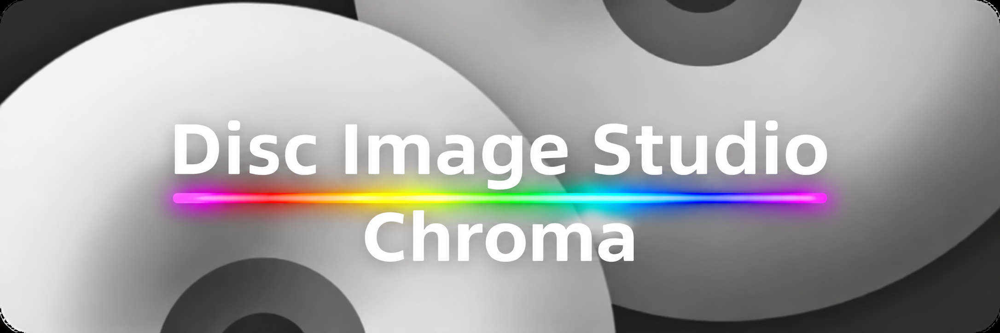

[简体中文](README.md) | [繁體中文](README.zh-TW.md) | **English** | [日本語](README.ja.md) | [Türkçe](README.tr.md) | [Español](README.es.md) | [Čeština](README.cs.md) | [Português (Brasil)](README.pt-BR.md)

<h2>An all-in-one tool for generating and burning visible images onto optical discs</h2>

Disc Image Studio Chroma is a multi-platform disc-surface image generation and burning tool that helps you etch images visible to the naked eye onto any DVD / CD / single-layer Blu-ray disc with any recorder.

---

## About this fork

This is [MissPinkElfLady/DiscImageStudio-Chroma](https://github.com/MissPinkElfLady/DiscImageStudio-Chroma), MissPinkElfLady's fork of [Disc Image Studio](https://github.com/JiaFeiMiao-K-Cat/DiscImageStudio) by JiaFeiMiao-K-Cat and contributors. It adds **diffraction-grating pictures for DVD-R**, including **colour pictures**. Everything else is upstream Disc Image Studio. The fork is not affiliated with or endorsed by the upstream project or by the authors of the projects credited below.

**Download:** ready-to-run builds of this fork are on its [Releases page](https://github.com/MissPinkElfLady/DiscImageStudio-Chroma/releases): `win-x64.exe` for Windows x64, `win-arm64.exe` for Windows 11 ARM64, and experimental CLI archives for Linux and macOS.

### What the fork adds

- **Diffraction engine** (`diffract` command, `src/DvdImageSolver/Diffraction`): writes several gratings with different periods, so different pictures are seen from different directions. This gives single pictures, two-frame flips that switch as the disc tilts, and stereo pairs. The output matches DiscDiffractStudio byte for byte (see below).
- **Colour pictures** (`"effect": "color"`): one colour image. Red, green and blue are written on three 91-byte carrier strings (16T, 13.93T and 12.13T), with period compensation for each cell and white balance. `"copies": 2` writes the picture again for a second tilt.
- **Whole-disc colour** (`"coverage": "wide"`): one colour picture written over the entire disc. Under one lamp it shows as two opposite wedges across the hub. Moving the lamp or turning the disc sweeps the wedges round and reveals the rest. One lamp position can never light a whole turn of the spiral; [docs/DIFFRACTION.md](docs/DIFFRACTION.md) explains why.
- **In the app, for DVD projects:**
  - A **Grayscale | Color** switch on the Design page (above the tone panel) and on the Export page, saved with the project.
  - With **Color**, Export and Burn write the design as one whole-disc colour picture, placed where the grayscale picture would be.
  - The tone panel hides dithering, brightness and sRGB linearization, and its preview shows the picture in colour.
  - The live preview's design projection shows the colours as written.
  - **Output read-back decodes a colour ISO from its bytes.** It has its own Grayscale | Color switch, set automatically from the `.iso.json` sidecar that the app writes next to each ISO.
- **CLI previews:**
  - `diffract --preview disc.png` draws a layout.
  - `--preview-light DEGREES` simulates the disc under a lamp at that clock angle.

Limits and known issues:
- Only blank single-layer DVD-R has been tried.
- A colour disc cannot carry files yet.
- Multi-frame animation is not ported.
- On synthetic test patterns such as a colour wheel, faint curved radial lines can appear. They have not been seen with real pictures.

Details: [docs/DIFFRACTION.md](docs/DIFFRACTION.md), [CHANGELOG.md](CHANGELOG.md).

### Code studied and ported

- **[Disc Image Studio](https://github.com/JiaFeiMiao-K-Cat/DiscImageStudio)** (GPL-3.0-or-later) is the base of this fork. The additions build on its EFMPlus tables, scrambler, ECC encoder, dispersion writer, calibration geometry and WPF app, and extend them in place.
- **[DiscDiffractStudio](https://github.com/Neo-626/DiscDiffractStudio)** by Neo-626 (GPL-3.0-or-later). The diffraction engine is a C# port of its Python engine:
  - `dvdgrating/carriers.py` (single-byte carriers, bridge bytes)
  - `dvdgrating/strings.py` (carrier strings)
  - `dvdgrating/viewing.py` (viewing model and white balance)
  - `multiview.Picture`, `DiscLayout` and `BlockMapper` (turn allocation and layout), and its colour flip
  
  Its carrier-string table `data/string_carriers.json` is embedded as `src/DvdImageSolver/Diffraction/string_carriers.json.gz`. `tools/DiffractionParity` holds the scripts that generate the parity vectors from a DiscDiffractStudio checkout. Each ported file names its source.
- **[Disc Color Studio](https://github.com/Neo-626/DiscColorStudio)** by Neo-626 (GPL-3.0). It was read for background: its measured colour tables, and why large colour images cut off at some angles. No code or data was copied from it.
- **[CDImage](https://github.com/arduinocelentano/cdimage)** by arduinocelentano (GPL-3.0-or-later) is credited by upstream for the CD interleaving code. The fork did not change that code.

### AI-generated code

All of the fork's additions were written by AI: Anthropic's Claude, working in Claude Code. That covers the code, tests, parity scripts, documentation and this section. MissPinkElfLady directed the work, tested the builds and burned discs. The code was not written by hand. Commits made this way carry a `Co-Authored-By: Claude` trailer. Upstream Disc Image Studio and DiscDiffractStudio belong to their own authors; DiscDiffractStudio's README states that it was itself created entirely by AI.

### Licence

The fork stays under the [GNU GPL v3.0 or later](LICENSE), the same as upstream. The ported DiscDiffractStudio code and data are GPL-3.0-or-later, which is compatible. Nothing was taken from Disc Color Studio. If you distribute binaries or modified versions, you must provide the matching source code and keep the copyright and licence notices; see [LICENSE-NOTICE.md](LICENSE-NOTICE.md).

---

## Results

  
  
  

---

## Overview

Disc Image Studio Chroma converts an image into data that meets the physical-layer constraints of CD, DVD, and single-layer BD-R discs. After burning, the disc surface displays a pattern visible to the naked eye.

## Interface Preview

---

## Using Disc Image Studio

This fork changes only what [About this fork](#about-this-fork) lists. For everything else, use the original project's documentation:
- getting started
- features
- calibration tutorials
- building from source
- the command line
- source layout
- reference standards

**[JiaFeiMiao-K-Cat/DiscImageStudio](https://github.com/JiaFeiMiao-K-Cat/DiscImageStudio)**: [README](https://github.com/JiaFeiMiao-K-Cat/DiscImageStudio#readme), [docs](https://github.com/JiaFeiMiao-K-Cat/DiscImageStudio/tree/main/docs), [DVD calibration tutorial](https://github.com/JiaFeiMiao-K-Cat/DiscImageStudio/blob/main/docs/CALIBRATION_TUTORIAL.md).

The copies of those documents in this repository match upstream at the point the fork was made. The diffraction and colour features are described in [docs/DIFFRACTION.md](docs/DIFFRACTION.md).

## System and Hardware Requirements

- The x64 desktop app requires Windows 10 2004 (2004/20H1, 19041) or later, or Windows 11. The ARM64 app requires Windows 11. Native ARM64 CI covers software self-tests and GUI snapshots; physical disc burning on ARM64 remains unverified.
- Building: .NET 10 SDK (`global.json` pins 10.0.x). A non-self-contained GUI built from source requires the .NET 10 Windows Desktop Runtime. The Release EXE includes the runtime, so a separate .NET installation is unnecessary.
- Live burning requires a CD / DVD / BD recorder recognized by Windows and blank media. BD-R requires a blank single-layer disc that supports sequential writing.

## Burning and Media Safety

- Disc Image Studio Chroma does not install drivers or services. Live burning uses Windows’ built-in IMAPI2 and rejects non-blank media.
- Live burning has received some feedback from physical disc tests, but validation coverage across different devices, media, and burning paths remains limited. It is experimental; use only expendable test media. Interrupted burning, power loss, or insufficient generation speed may still render a disc unusable!
- The actual visible result depends on the disc, recorder, firmware, and write strategy.
- For hybrid discs, the source folder is scanned and its layout is fixed before burning starts. If a source file’s size changes during the operation, the job is safely terminated; a disc that has already started writing may still become unusable.
- BD-R sequential writing does not provide spare-area remapping. After an interruption, writing to the same disc generally cannot continue.

## Privacy and Security

- Except when the user manually checks for updates on the About page, Disc Image Studio Chroma does not access the network, upload files, or collect telemetry. See the [privacy policy](PRIVACY.md).
- Do not disclose security issues in public issues. Follow the [security policy](SECURITY.md) and use GitHub’s private reporting feature.

## Contributing

Issue reports and code contributions are welcome. See the [contributing guide](CONTRIBUTING.md) for development environment setup, module boundary rules, testing requirements, and the pull request process.

## License

This project is licensed under [GNU GPL v3.0 or later](LICENSE) (`GPL-3.0-or-later`). The CD interleaving implementation includes code ported and modified from CDImage, and the project as a whole is distributed under a compatible GPL license. Distributing binaries or modified versions requires compliance with the corresponding-source and other applicable requirements. The diffraction engine added in this fork is ported from DiscDiffractStudio (GPL-3.0-or-later); see [About this fork](#about-this-fork). Third-party fonts and components retain their own licenses; see the [license notice](LICENSE-NOTICE.md) and [third-party notices](THIRD-PARTY-NOTICES.txt). The full texts are also available offline on the app’s About page.

## Acknowledgments

Thanks to [arduinocelentano’s CDImage project](https://github.com/arduinocelentano/cdimage), which demonstrated how to create visible images on a disc surface by generating CD audio tracks. This project’s CD interleaving implementation was ported from its related code and further modified, and the approach to drawing on CD surfaces was also inspired by it. The work of CDImage’s original author and contributors provides an important foundation for this project.

This fork also thanks Neo-626 for [DiscDiffractStudio](https://github.com/Neo-626/DiscDiffractStudio), whose engine its diffraction and colour pictures are ported from, and for [Disc Color Studio](https://github.com/Neo-626/DiscColorStudio), which informed the colour work.
